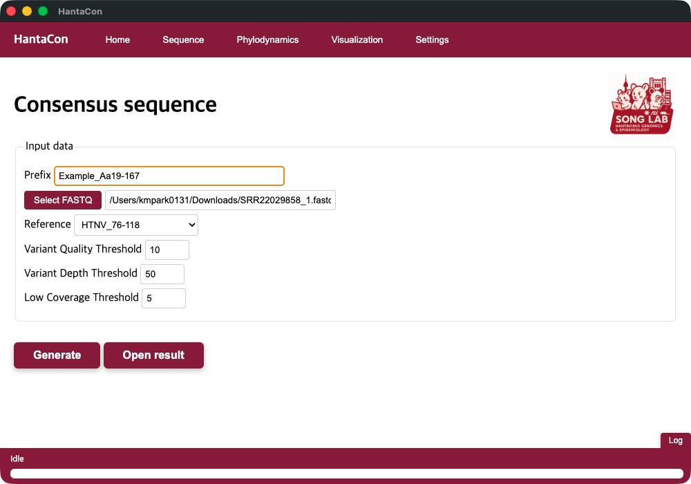
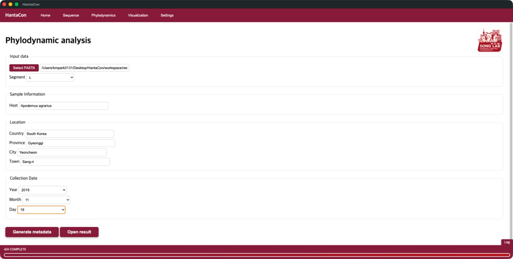
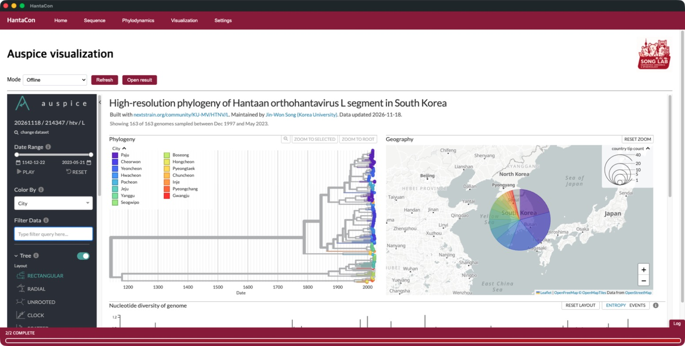

# HantaCon documentation

Manual for [HantaCon](README.md). Installation and a quick start are in the README.

## Contents

- [Usage](#usage)
- [Updating](#updating)
- [Uninstalling](#uninstalling)
- [Building from source](#building-from-source)
- [Architecture](#architecture)
- [Directory layout](#directory-layout)
- [Bioinformatics tools](#bioinformatics-tools)
- [Consensus workflow](#consensus-workflow)
- [Phylodynamics workflow](#phylodynamics-workflow)
- [Supported location names](#supported-location-names)
- [Reference database](#reference-database)
- [Rebuilding the backend](#rebuilding-the-backend)
- [Troubleshooting](#troubleshooting)
- [Tool references](#tool-references)

## Usage

HantaCon supports two analysis modes:

1. **FASTQ workflow**: Nanopore reads → consensus genome generation → phylogeographic analysis → Nextstrain visualization
2. **FASTA workflow**: prepared HTNV genome sequences → phylogeographic analysis → Nextstrain visualization

The interface is organized into five tabs: **Home**, **Sequence**, **Phylodynamics**, **Visualization**, and **Settings**.

### 1. Home


The Home tab shows an overview of HantaCon and lab/administrator information.

### 2. Sequence: consensus generation



Enter a sample prefix, select a FASTQ file, and choose the reference genome (HTNV_76-118 or HTNV_Ac20-5). The consensus thresholds can be adjusted:

| Parameter | Default |
|---|---|
| Variant quality threshold | 10 |
| Variant depth threshold | 50 |
| Low coverage threshold | 5 |

Press **Generate** to run the workflow. Reads are aligned to the tripartite reference, segment-specific alignments are separated, variants are called and filtered, and low-coverage regions are masked. The output is one consensus FASTA file per segment, with the thresholds used for the run recorded in the FASTA header. Press **Open result** to view the output directory.

Variant calling uses the Medaka model `r941_prom_sup_variant_g507` (R9.4.1 flow cells, super-accuracy basecalling).

### 3. Phylodynamics: metadata and phylogenetic analysis



Select a consensus FASTA file and the corresponding genomic segment (L, M, or S), then enter the sample information used for phylogeographic placement: host species, location (country, province, city, and town; leave a level empty when it is not available), and collection date.

Only the first sequence in the selected FASTA file is analyzed, and its name (the FASTA header up to the first space) must not already exist in the reference database. Press **Generate metadata** to build the dataset and run the segment-specific analysis against the bundled reference database. Each segment is analyzed separately.

### 4. Visualization: interactive exploration



**Offline** mode shows the results stored on this computer (served at `http://localhost:4000`); click a dataset name to open it. **Online** mode opens auspice.us, where result files from `~/Desktop/HantaCon/workspace/result/<date_time>/` can be dragged onto the page; drag the three `htv_<segment>*.json` files together.

Tips can be coloured by metadata field, filtered by query, and restricted to a date range. The Geography panel maps sequences by their annotated locality, the entropy panel shows nucleotide diversity across the genome, and the frequency panel shows tip frequencies over time.

### 5. Settings: backend management

**Restart Services** starts the backend containers again. **Reinstall Services** downloads the latest `nextstrain/base` image and recreates both containers. Use these if an analysis stops with a Docker error. To rebuild the `hantacon_core` image, see [Rebuilding the backend](#rebuilding-the-backend).

## Updating

For an installation built from source (see [Building from source](#building-from-source)):

**macOS**

```bash
cd ~/KU-HantaCon
git pull
npm install
rm -rf dist
npm run build:mac
cd ~/Desktop/HantaCon && docker compose down --rmi local && rm dockerfile env.yml docker-compose.yml
```

Then install the new `.dmg` from `dist` as in [Building from source](#building-from-source) and choose **Replace**.

**Ubuntu Linux**

```bash
cd ~/KU-HantaCon
git pull
npm install
rm -rf dist
npm run build:linux
sudo apt install ./dist/hantacon_*.deb
cd ~/Desktop/HantaCon && docker compose down --rmi local && rm dockerfile env.yml docker-compose.yml
```

`sudo apt install` replaces the installed version.

With a downloaded package, install the newer package from [Releases](https://github.com/KU-MV/KU-HantaCon/releases/latest) as in the [README](README.md#installation) (macOS: choose **Replace**; Ubuntu: `sudo apt install` replaces the installed version), then run the last line of the block above.

The last line removes the old analysis environment. HantaCon copies the new Docker files at the next start and rebuilds the environment at the next analysis.

## Uninstalling

Back up anything you need from `~/Desktop/HantaCon/workspace/result` first, then:

**macOS**

```bash
cd ~/Desktop/HantaCon && docker compose down --rmi all --remove-orphans
rm -rf ~/Desktop/HantaCon
```

Then drag HantaCon from Applications to the Trash.

**Ubuntu Linux**

```bash
sudo apt remove hantacon
cd ~/Desktop/HantaCon && docker compose down --rmi all --remove-orphans
rm -rf ~/Desktop/HantaCon
```

`--rmi all` also removes the `nextstrain/base` image. Docker, Node.js, and Git stay installed. If you built from source, also remove the source folder with `rm -rf ~/KU-HantaCon`.

## Building from source

Building is needed only to change the code or to make your own packages. Prebuilt packages are on [Releases](https://github.com/KU-MV/KU-HantaCon/releases/latest).

### Prerequisites

Docker as in the [README](README.md#installation), plus Node.js 22.12 or later and Git.

**macOS**

1. Install Node.js: download the **LTS macOS Installer (.pkg)** from [nodejs.org/en/download](https://nodejs.org/en/download) and run it.
2. Check:

   ```bash
   docker compose version
   node -v
   git --version
   ```

   `node -v` must print `v22.12` or higher. If macOS offers to install the command line developer tools at `git --version`, press **Install**; this installs Git.

**Ubuntu Linux**

1. Install Git and Node.js:

   ```bash
   sudo apt install -y git curl
   curl -fsSL https://deb.nodesource.com/setup_lts.x -o nodesource_setup.sh
   sudo -E bash nodesource_setup.sh
   sudo apt install -y nodejs
   ```

   Do not install Node.js with `sudo apt install nodejs` alone: the version in Ubuntu's own repository is too old.

2. Check:

   ```bash
   docker run hello-world
   node -v
   git --version
   ```

   `node -v` must print `v22.12` or higher.

### Build and install

1. Download the source code and its dependencies:

   ```bash
   cd ~
   git clone https://github.com/KU-MV/KU-HantaCon.git
   cd KU-HantaCon
   npm install
   ```

   `npm install` may end with a message such as `11 vulnerabilities` and suggest `npm audit fix --force`. Ignore it; do not run `npm audit fix`.

2. Build the package:

   ```bash
   npm run build:mac        # macOS, about 1 minute
   npm run build:linux      # Ubuntu Linux, about 1.5 minutes
   ```

   The package is written to the `dist` folder. Building only creates the package; it does not install it.

   | | macOS | Ubuntu Linux |
   |---|---|---|
   | Files in `dist` | `HantaCon-<version>-arm64.dmg` (Apple silicon), `HantaCon-<version>.dmg` (Intel) | `hantacon_<version>_amd64.deb` (x86-64), or `_arm64.deb` when built on an ARM computer |

3. Install the package:

   - macOS: run `open dist`, double-click the `.dmg` for your chip, and drag HantaCon to Applications.
   - Ubuntu Linux:

     ```bash
     sudo apt install ./dist/hantacon_*.deb
     ```

     Enter your password when asked.

4. Start Docker, then open HantaCon:

   - macOS: open HantaCon from Applications.
   - Ubuntu Linux: open HantaCon from the applications menu, or run `hantacon` in a terminal.

### npm commands

Run inside the `KU-HantaCon` folder.

| Command | What it does |
|---|---|
| `npm install` | Downloads the dependencies pinned in `package-lock.json` into `node_modules`. Run after cloning and after each `git pull`. |
| `npm start` | Runs HantaCon from the source folder without building or installing it. |
| `npm run build:mac` | Builds `.dmg` and `.zip` packages for Apple silicon (arm64) and Intel (x64) into `dist/`. Must be run on a Mac. |
| `npm run build:linux` | Builds a `.deb` package into `dist/`. |
| `npm run build` | Runs both builds. |

### Running without installing (`npm start`)

The installed application is opened like any other program and runs on its own. Alternatively, HantaCon can be run directly from the source folder in the terminal, the way command-line tools are run. Nothing is built or installed, and HantaCon quits when that terminal session ends. This is useful for testing changes to the source code.

```bash
cd ~/KU-HantaCon
npm start
```

On Ubuntu 24.04 or later, if `npm start` stops with `The SUID sandbox helper binary was found, but is not configured correctly`, run the two commands under that error in [Troubleshooting](#troubleshooting) once, then `npm start` again.

## Architecture

HantaCon has two parts.

The **front end** is an Electron application. `main.js` creates the window, prepares the working directory, and handles file dialogs. `src/renderer.js` and `src/index.html` provide the five tabs. Analyses run in a worker thread (`workerWorkflow.js`) so the interface stays responsive, and the worker streams log lines back to the renderer.

The **backend** is two Docker Compose services, defined in `resources/docker/docker-compose.yml`:

| Service | Container | Image | Role |
|---|---|---|---|
| `hantacon_core` | `hantacon_core_env` | built locally from `resources/docker/dockerfile` | read mapping, variant calling, consensus generation, MAFFT alignment |
| `hantacon_nextstrain` | `hantacon_nextstrain_env` | `nextstrain/base` | Augur build and the Auspice server on port 4000 |

`hantacon_core` is built on `mambaorg/micromamba:1.5.8`, with the conda environment `HantaCon` defined in `resources/docker/env.yml`.

Workflow steps are declared as data in `workflow.js`, as a list of shell commands with placeholders. The worker substitutes paths and parameters and runs each command with `docker compose exec -T`.

## Directory layout

On first launch HantaCon creates `~/Desktop/HantaCon` and copies `.env`, `docker-compose.yml`, `dockerfile`, `env.yml`, and `scripts/filter_indel_with_sr.py` into it. Existing files are not overwritten.

```
~/Desktop/HantaCon/
├── .env                      # UID and GID used by the containers (Linux: set to your account automatically)
├── docker-compose.yml
├── dockerfile
├── env.yml
├── scripts/
│   └── filter_indel_with_sr.py
└── workspace/                # mounted into both containers as /workspace
    ├── auspice/              # Auspice JSONs served at localhost:4000
    ├── result/
    │   └── <YYYYMMDD_HHMMSS>/   # one directory per run
    └── work/
        ├── sequence/<run id>/
        └── phylodynamics/<run id>/
```

Each run creates a new timestamped directory, so earlier results are never overwritten. Intermediate files under `work/` can be deleted once a run has finished.

## Bioinformatics tools

Installed in the `hantacon_core` image from `resources/docker/env.yml`:

| Package | Version | Role |
|---|---|---|
| python | 3.10 | script runtime |
| medaka | 2.2.1 | read alignment (`mini_align`) and consensus variant calling |
| minimap2 | 2.31 | read mapping, used by `mini_align` |
| samtools | 1.23.1 | BAM sorting, indexing, segment extraction |
| bcftools | 1.24 | variant filtering and consensus application |
| htslib | 1.23.1 | `bgzip` and `tabix` |
| bedtools | 2.31.1 | coverage calculation and low-coverage masking |
| seqkit | 2.14.0 | installed; not used by the current workflow |
| mafft | 7.526 | multiple sequence alignment |
| vcfpy | 0.13.6 | used by `filter_indel_with_sr.py` |
| k8 | 1.2 | JavaScript runtime required by `mini_align` |

Augur, IQ-TREE, TreeTime, and Snakemake come from the `nextstrain/base` image and are not installed in `hantacon_core`.

All versions are pinned in `env.yml`, and packages come only from the conda-forge and bioconda channels. The same versions are installed on Intel (linux-64) and Apple silicon or ARM (linux-aarch64) machines. The `nextstrain/base` image is not pinned and is downloaded at its latest version.

## Consensus workflow

Defined in `workflow.js` as `Sequence`. The three segments are processed by identical steps.

1. **Map reads.** The L, M, and S reference FASTA files for the selected reference are concatenated, reads are aligned with `mini_align -m -f -M 2 -S 4 -O 4,24 -E 2,1`, and the sorted BAM is split per segment with `samtools view` on the reference sequence name.
2. **Call variants.** `medaka inference` with model `r941_prom_sup_variant_g507`, then `medaka vcf` and `medaka tools annotate --dpsp`.
3. **Filter.** `bcftools view -i 'QUAL>{quality} & INFO/DP>{depth}'`, then `filter_indel_with_sr.py`, which keeps an indel only when the strand-read support for the reference allele is lower than for the alternate allele.
4. **Build consensus.** `bcftools consensus` against the segment reference.
5. **Mask low coverage.** `bedtools genomecov -bga`, positions below the low-coverage threshold are merged with `bedtools merge` and masked with `bedtools maskfasta`.
6. **Label.** The FASTA header is rewritten as `><prefix>_<segment> low_cov_thrs=… var_qual_thrs=… var_depth_thrs=…`.

Bundled references, under `resources/reference/`:

| Key | Strain | Available in the interface |
|---|---|---|
| `HTNV_76-118` | HTNV 76-118 | yes |
| `HTNV_Ac20-5` | HTNV Ac20-5 | yes |
| `DOBV`, `PUUV`, `SEOV`, `SNV` | Dobrava, Puumala, Seoul, Sin Nombre | bundled, not selectable in the current interface |

## Phylodynamics workflow

Defined in `workflow.js` as `Phylodynamic`.

The template for the selected segment (`resources/template/htv_L`, `htv_M`, or `htv_S`) is copied into the run directory. The first record of the selected consensus FASTA is appended to `data/sequence.fasta`, and a metadata row built from the form fields is appended to `data/metadata.tsv`. Any further records in the file are ignored. The strain name is the first FASTA header, up to the first space. It must not duplicate a strain already in the reference dataset.

The metadata columns, in order:

```
strain, host, genetic exchange, lineage, hybrid zone, accession, date,
province, country, city, town, db, title, journal, paper_url
```

Then MAFFT aligns `data/sequence.fasta` in the `hantacon_core` container, and `snakemake -c 4` runs the Augur build in the `hantacon_nextstrain` container. The Snakefile runs `augur index`, `filter`, `tree`, `refine` (time tree, marginal date inference, `opt` coalescent), `traits` (on `province`, with confidence), `ancestral` (joint), `translate`, `export v2`, and `frequencies` (KDE).

The resulting `auspice/htv_<segment>.json` and its two sidecar files, `htv_<segment>_tip-frequencies.json` and `htv_<segment>_root-sequence.json`, are copied to the run result directory and to `workspace/auspice/`, where the Auspice server picks them up.

## Supported location names

A sequence is placed on the Geography panel only when its `country`, `province`, `city`, and `town` values match an entry in `config/lat_longs.tsv`. The table is identical for all three segments. Matching ignores capitalization but is otherwise exact, including spacing and hyphens. A value with no entry is reported by Augur as `did not have an associated lat/long value` and is not placed at that level; it also appears as a separate category in the colour legend. For example, entering `Korea` instead of `South Korea` splits the country legend into two entries. Leave a level blank rather than typing a placeholder such as `unknown`.

**Country (3)**
China, Russia, South Korea

**Province (30)**
Anhui, Chungbuk, Daegu, Fuyuan, Gangwon, Guizhou, Gyeongbuk, Gyeonggi, Gyeongnam, Gyeongsang, Heilongjiang, Henan, Hubei, Hunan, Jeju, Jeollabuk, Jeonnam, Jiangsu, Jiangxi, Jilin, Khabarovsk, Liaoning, Longquan, Seoul, Shaanxi, Shandong, Shichuan, Tianjin, Yunan, Zhejiang

**City (37)**
Anhui, Boseong, Cheorwon, Chuncheon, Dongducheon, Fuyuan, Guizhou, Gwangju, Heilongjiang, Henan, Hongcheon, Hubei, Hunan, Hwacheon, Inje, Jeju, Jiangsu, Jiangxi, Jilin, Khabarovsk, Liaoning, Longquan, Muju, Paju, Pocheon, Pyeongchang, Pyeongtaek, Seogwipo, Seoul, Shaanxi, Shandong, Shichuan, Tianjin, Yanggu, Yeoncheon, Yunan, Zhejiang

**Town (41)**
Baegyeon-ri, Bongseong-ri, Dochang-ri, Dongi-ri, Dosin-ri, Duil-ri, Gaekhyeon-ri, Gapdun-ri, Guun-ri, Gwanu-ri, Hogeun-dong, Hyeonga-ri, Icheon-ri, Jajak-ri, Jangam-ri, Jangjwa-ri, Jikcheon-ri, Majeon-ri, Mandae-ri, Mugeon-ri, Munhye-ri, Nogok-ri, Ohyeon-ri, Oji-ri, Okgye-ri, Ora-2-dong, Pungam-ri, Pungsan-ri, Samil-ri, Sang-ri, Sangdae-ri, Sangsa-ri, Sanyang-ri, Seongok-ri, Sinchon-ri, Sindap-ri, Tonghyeon-ri, Uncheon-ri, Wacho-ri, Wangnim-ri, Yuli-ri

To add a location, append a row to `config/lat_longs.tsv` in each segment template, in the form `level<TAB>name<TAB>latitude<TAB>longitude`.

## Reference database

Each segment template under `resources/template/` carries its own dataset:

| Segment | Sequences in `data/sequence.fasta` | Rows in `data/metadata.tsv` |
|---|---|---|
| L | 162 | 163 |
| M | 163 | 164 |
| S | 164 | 165 |

The extra metadata row in each case is HTNV 76-118, which is supplied as the annotated reference (`config/reference.gb`) rather than as a dataset sequence.

Sequences and metadata were retrieved from GenBank on 30 August 2025. `config/colors.tsv` assigns colors for the country, province, host, lineage, genetic exchange, and hybrid zone categories. `config/dropped_strains.txt` is empty, so no strain is excluded at the filter step.

<!-- TODO: add the inclusion and exclusion criteria used when assembling the dataset. -->

## Rebuilding the backend

**Restart Services** in the Settings tab runs:

```bash
docker compose -f ~/Desktop/HantaCon/docker-compose.yml up -d --remove-orphans
```

**Reinstall Services** runs:

```bash
docker compose -f ~/Desktop/HantaCon/docker-compose.yml pull
docker compose -f ~/Desktop/HantaCon/docker-compose.yml up -d --force-recreate
```

Neither rebuilds the locally built `hantacon_core` image. After editing `dockerfile` or `env.yml`, rebuild it from a terminal:

```bash
cd ~/Desktop/HantaCon
docker compose build --no-cache hantacon_core
docker compose up -d --force-recreate hantacon_core
```

Note that HantaCon copies the Docker files into `~/Desktop/HantaCon` only when they are absent. Editing the copies in `resources/docker/` in the repository has no effect on an existing installation unless the corresponding files in `~/Desktop/HantaCon` are deleted first.

## Troubleshooting

**`node -v` prints a version lower than 22.12, or `npm install` reports an unsupported engine.**
Install the current LTS release of Node.js as described in [Building from source](#prerequisites). On Ubuntu, `sudo apt install nodejs` without the NodeSource step installs a version that is too old.

**`permission denied while trying to connect to the Docker daemon socket` (Linux).**
Your account is not yet in the `docker` group. Run `sudo usermod -aG docker $USER`, log out, log back in, and try again.

**`npm start` stops with `The SUID sandbox helper binary was found, but is not configured correctly` (Ubuntu 24.04 or later).**
Run once, inside the `KU-HantaCon` folder:

```bash
sudo chown root:root node_modules/electron/dist/chrome-sandbox
sudo chmod 4755 node_modules/electron/dist/chrome-sandbox
```

Repeat after `npm install` replaces the Electron runtime.

**An analysis fails immediately with a Docker error.**
Check that Docker is running (macOS: Docker Desktop shows **Engine running**) and that `docker compose version` works in Terminal. Then press **Restart Services** in the Settings tab.

**The first analysis seems stuck.**
On first use the `hantacon_core` image is built and the `nextstrain/base` image is downloaded, several GB in total. The log may show no new lines for several minutes. Wait until the status bar changes.

**The Nextstrain build stops with `Sequence ids must be unique`.**
The strain name taken from your FASTA header already exists in the reference dataset, for example when re-analyzing a GenBank sequence that is part of the database. Rename the FASTA header and run again.

**Only one of several specimens was analyzed in the Phylodynamics tab.**
Only the first record of the selected FASTA file is read. Put each specimen in its own file and run them one at a time.

**A new sequence does not appear on the map, or the country legend shows two entries.**
Its location names must match `config/lat_longs.tsv`. See [Supported location names](#supported-location-names).

**The offline viewer shows nothing, or a new run is missing.**
Press **Refresh**. Confirm that `hantacon_nextstrain_env` is running (`docker ps`) and that no other program uses port 4000. At least one completed Phylodynamics run is needed.

## Tool references

- Hadfield J, et al. Nextstrain: real-time tracking of pathogen evolution. *Bioinformatics* 34, 4121-4123 (2018).
- Huddleston J, et al. Augur: a bioinformatics toolkit for phylogenetic analyses of human pathogens. *J Open Source Softw* 6, 2906 (2021).
- Li H. Minimap2: pairwise alignment for nucleotide sequences. *Bioinformatics* 34, 3094-3100 (2018).
- Danecek P, et al. Twelve years of SAMtools and BCFtools. *GigaScience* 10, giab008 (2021).
- Quinlan AR, Hall IM. BEDTools: a flexible suite of utilities for comparing genomic features. *Bioinformatics* 26, 841-842 (2010).
- Katoh K, Standley DM. MAFFT multiple sequence alignment software version 7. *Mol Biol Evol* 30, 772-780 (2013).
- Minh BQ, et al. IQ-TREE 2: new models and efficient methods for phylogenetic inference in the genomic era. *Mol Biol Evol* 37, 1530-1534 (2020).
- Sagulenko P, Puller V, Neher RA. TreeTime: maximum-likelihood phylodynamic analysis. *Virus Evol* 4, vex042 (2018).
- Mölder F, et al. Sustainable data analysis with Snakemake. *F1000Research* 10, 33 (2021).
- Medaka. Oxford Nanopore Technologies. https://github.com/nanoporetech/medaka
