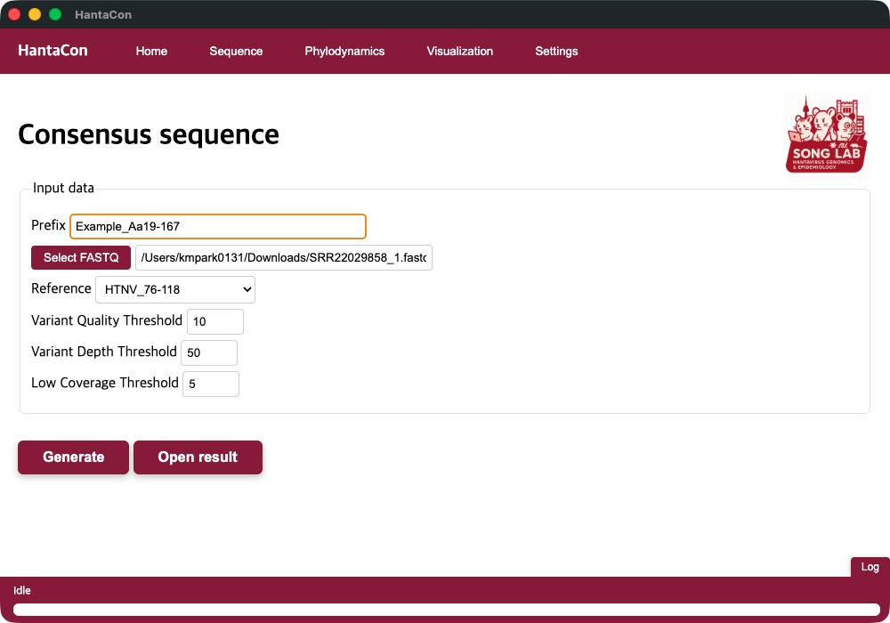

# HantaCon


### [Install](#installation) · [Documentation](DOCS.md) · [Citation](#citation) · [Issues](https://github.com/KU-MV/KU-HantaCon/issues)

**HantaCon** is an integrated desktop application for genomic surveillance and phylogeographic visualization of **Hantaan virus (HTNV)**.


HantaCon combines automated consensus genome generation from Oxford Nanopore sequencing reads, a curated geographically annotated Korean HTNV reference database, and localized Nextstrain visualization within a graphical desktop environment.

**From reads to consensus genomes.**
HantaCon generates L-, M-, and S-segment consensus sequences from Oxford Nanopore sequencing reads using the KU-ONT-HTNV-consensus workflow. Reads are aligned to the tripartite genome of HTNV strain 76-118 (GenBank NC_005222, NC_005219, and NC_005218 for the L, M, and S segments), and consensus sequences are called with user-adjustable thresholds.

**From genomes to geographic context.**
Newly generated HTNV sequences can be analyzed together with a curated Korean reference database containing geographic, temporal, host, and lineage metadata. Specimen metadata are entered through the interface, so no external metadata file needs to be prepared.

**Interactive phylogeographic visualization.**
Segment-specific phylogenetic analyses are performed using a localized Nextstrain workflow and visualized interactively with Auspice, including a phylogenetic tree, a geographic map, a genome-wide nucleotide diversity panel, and a tip frequency panel.

**A desktop workflow.**
HantaCon integrates an Electron-based graphical user interface with a Docker-containerized bioinformatics backend, reducing the need to operate individual command-line tools. Prepared HTNV FASTA sequences can also be analyzed directly, bypassing the consensus-generation step.

## Requirements

- macOS (Apple silicon or Intel), or Ubuntu Linux 22.04 or later
- Free disk space for Docker Desktop, Node.js, and the HantaCon Docker images (the images use about 6.5 GB)
- Internet connection for the first installation and the first analysis

Three programs must be installed first: **Docker**, **Node.js** (version 22.12 or later), and **Git**. The steps below install all three. All bioinformatics tools run inside Docker and do not need to be installed separately. The full tool list is in [DOCS.md](DOCS.md).

Runtime reference (benchmark hardware, not a minimum requirement): for the datasets described in the associated study, analysis of the L, M, and S segments, from prepared FASTQ reads through consensus generation to localized Nextstrain visualization, completed within approximately 15 minutes on a MacBook Pro (Apple M3 Pro, 36 GB RAM), excluding sequencing and manual gap-filling time.

## Installation

HantaCon is installed as a desktop application: a `.dmg` on macOS and a `.deb` on Ubuntu. Install the prerequisites (step 1), then install the application (step 2).

### Step 1. Install the prerequisites

| Program | Needed for |
|---|---|
| Docker | Running analyses. Always required. |
| Node.js 22.12 or later | Building HantaCon from source (step 2, option B) and `npm start`. |
| Git | Downloading the source code (step 2, option B). |

**macOS**

1. Install Docker Desktop for your chip (Apple silicon or Intel) from [docs.docker.com/desktop/setup/install/mac-install](https://docs.docker.com/desktop/setup/install/mac-install/). Open `Docker.dmg`, drag Docker to Applications, and open Docker. Signing in is optional (press **Skip**). Wait until Docker Desktop shows **Engine running**.
2. Install Node.js: download the **LTS macOS Installer (.pkg)** from [nodejs.org/en/download](https://nodejs.org/en/download) and run it.
3. Check all three:

   ```bash
   docker compose version
   node -v
   git --version
   ```

   `node -v` must print `v22.12` or higher. If macOS offers to install the command line developer tools at `git --version`, press **Install**; this installs Git.

**Ubuntu Linux**

1. Install Git, Docker, and Node.js:

   ```bash
   sudo apt update
   sudo apt install -y git curl
   curl -fsSL https://get.docker.com -o get-docker.sh
   sudo sh get-docker.sh
   sudo usermod -aG docker $USER
   curl -fsSL https://deb.nodesource.com/setup_lts.x -o nodesource_setup.sh
   sudo -E bash nodesource_setup.sh
   sudo apt install -y nodejs
   ```

   Do not install Node.js with `sudo apt install nodejs` alone: the version in Ubuntu's own repository is too old.

2. **Log out and log back in**, so that Docker can be used without `sudo`. Then check:

   ```bash
   docker run hello-world
   node -v
   git --version
   ```

   `docker run hello-world` must print a "Hello from Docker!" message, and `node -v` must print `v22.12` or higher.

### Step 2. Install HantaCon as an application

**Option A. Download a package**

Download the package for your platform from the [Releases](https://github.com/KU-MV/KU-HantaCon/releases) page.

- Ubuntu Linux:

  ```bash
  sudo apt install ./hantacon_<version>_amd64.deb
  ```

- macOS: open the downloaded `.dmg` and drag HantaCon to Applications. The application is not notarized, so macOS may block the first launch. Allow it under System Settings, Privacy & Security.

**Option B. Build the package from source**

1. Download the source code and its dependencies:

   ```bash
   cd ~
   git clone https://github.com/KU-MV/KU-HantaCon.git
   cd KU-HantaCon
   npm install
   ```

   `npm install` may end with a message such as `11 vulnerabilities` and suggest `npm audit fix --force`. Ignore it; do not run `npm audit fix`.

2. Build and install the package.

   macOS (about 1 minute):

   ```bash
   npm run build:mac
   open dist
   ```

   In the `dist` folder that opens, double-click `HantaCon-<version>-arm64.dmg` (Apple silicon) or `HantaCon-<version>.dmg` (Intel), and drag HantaCon to Applications.

   Ubuntu Linux:

   ```bash
   npm run build:linux
   sudo apt install ./dist/hantacon_*.deb
   ```

3. Start Docker, then open HantaCon from Applications (macOS) or the applications menu (Ubuntu).

### npm commands

Run these inside the `KU-HantaCon` folder.

| Command | What it does |
|---|---|
| `npm install` | Downloads the dependencies pinned in `package-lock.json` into `node_modules`. Run after cloning and after each `git pull`. |
| `npm start` | Runs HantaCon directly from the source folder, without building or installing it. HantaCon quits when this Terminal session ends. |
| `npm run build:mac` | Builds `.dmg` and `.zip` packages for Apple silicon (arm64) and Intel (x64) into `dist/`. Must be run on a Mac. |
| `npm run build:linux` | Builds a `.deb` package into `dist/`. |
| `npm run build` | Runs both builds. |

On Ubuntu 24.04 or later, if `npm start` stops with `The SUID sandbox helper binary was found, but is not configured correctly`, run the two commands under that error in [DOCS.md](DOCS.md#troubleshooting) once, then `npm start` again.

### Updating

For an installation built from source (option B):

```bash
cd ~/KU-HantaCon
git pull
npm install
npm run build:mac        # Ubuntu: npm run build:linux
cd ~/Desktop/HantaCon && docker compose down --rmi local && rm dockerfile env.yml docker-compose.yml
```

Then install the new package as in step 2 (macOS: choose **Replace** when dragging to Applications). For option A, install the newer package from Releases and run the last line above.

The last line removes the old analysis environment. HantaCon copies the new Docker files at the next start and rebuilds the environment at the next analysis.

### Uninstalling

Back up anything you need from `~/Desktop/HantaCon/workspace/result` first, then:

**Ubuntu Linux**

```bash
sudo apt remove hantacon
cd ~/Desktop/HantaCon && docker compose down --rmi all --remove-orphans
rm -rf ~/Desktop/HantaCon
```

**macOS**

```bash
cd ~/Desktop/HantaCon && docker compose down --rmi all --remove-orphans
rm -rf ~/Desktop/HantaCon
```

Then drag HantaCon from Applications to the Trash.

`--rmi all` also removes the `nextstrain/base` image. Docker, Node.js, and Git stay installed. If you built from source, also remove the source folder with `rm -rf ~/KU-HantaCon`.

## First launch

Make sure Docker is running before opening HantaCon (macOS: Docker Desktop shows **Engine running**).

On launch, HantaCon creates its working directory at `~/Desktop/HantaCon` and writes its Docker Compose configuration there. Analysis inputs, intermediate files, and results are all kept under that directory.

The backend containers are built the first time an analysis is started, not at launch. The first Sequence run builds the `hantacon_core` image, and the first Phylodynamics run downloads the `nextstrain/base` image. Together these download several GB. During the download the application log may show no new lines for several minutes; this is normal. Later runs start immediately.

## Quick start

**Example data.** The example uses public Oxford Nanopore reads of sample Aa19-167 (SRA run SRR22029858, BioProject PRJNA893834) from:

> Park K, Lee S-H, Kim J, et al. Multiplex PCR-Based Nanopore Sequencing and Epidemiological Surveillance of *Hantaan orthohantavirus* in *Apodemus agrarius*, Republic of Korea. *Viruses* 13, 847 (2021). https://doi.org/10.3390/v13050847

Download the reads (about 95 MB; this can take several minutes) into the Downloads folder:

```bash
cd ~/Downloads
curl -O https://ftp.sra.ebi.ac.uk/vol1/fastq/SRR220/058/SRR22029858/SRR22029858_1.fastq.gz
gunzip SRR22029858_1.fastq.gz
```

1. **Sequence tab**: Generate consensus genomes
   - Prefix: `Example_Aa19-167`. A prefix may contain only letters, numbers, `-` and `_`.
   - **Select FASTQ**: `Downloads/SRR22029858_1.fastq`
   - Reference: `HTNV_76-118`. Leave the three thresholds at their defaults.
   - Press **Generate**. When the status bar shows **COMPLETE**, `Example_Aa19-167_L.fasta`, `Example_Aa19-167_M.fasta`, and `Example_Aa19-167_S.fasta` are in `~/Desktop/HantaCon/workspace/result/<date_time>/`.

2. **Phylodynamics tab**: Run the analysis on the L segment
   - **Select FASTA**: `Example_Aa19-167_L.fasta` from the result folder of step 1
   - Segment: `L`
   - Host: `Apodemus agrarius`
   - Location: Country `South Korea`, Province `Gyeonggi`, City `Yeoncheon`, Town `Sang-ri`
   - Collection Date: `2019`, `11`, `19`
   - Press **Generate metadata**. Wait until the status bar shows **COMPLETE**.

3. **Visualization tab**: Open the result in Auspice
   - Set **Mode** to **Offline**.
   - Click the dataset under **Available datasets**. Its name is the run date and time, for example `20261118/214347/htv/L`. If it is not listed, press **Refresh**.

The reference database already contains this sample as `HTNV_Aa19-167`.

Location names must be spelled as in the bundled coordinate table (capitalization is ignored), for example `South Korea`, not `Korea`. Leave a field empty if it is unknown. The list of accepted names is in [DOCS.md](DOCS.md#supported-location-names).

## Usage

HantaCon supports two analysis modes:

1. **FASTQ workflow**: Nanopore reads → consensus genome generation → phylogeographic analysis → Nextstrain visualization
2. **FASTA workflow**: prepared HTNV genome sequences → phylogeographic analysis → Nextstrain visualization

The interface is organized into five tabs: **Home**, **Sequence**, **Phylodynamics**, **Visualization**, and **Settings**.

### 1. Home


The Home tab shows an overview of HantaCon and lab/administrator information.

### 2. Sequence: consensus generation



Enter a sample prefix, select a FASTQ file, and choose the reference genome (HTNV_76-118 or HTNV_Ac20-5). The consensus thresholds can be adjusted:

| Parameter | Default |
|---|---|
| Variant quality threshold | 10 |
| Variant depth threshold | 50 |
| Low coverage threshold | 5 |

Press **Generate** to run the workflow. Reads are aligned to the tripartite reference, segment-specific alignments are separated, variants are called and filtered, and low-coverage regions are masked. The output is one consensus FASTA file per segment, with the thresholds used for the run recorded in the FASTA header. Press **Open result** to view the output directory.

Variant calling uses the Medaka model `r941_prom_sup_variant_g507` (R9.4.1 flow cells, super-accuracy basecalling).

### 3. Phylodynamics: metadata and phylogenetic analysis


Select a consensus FASTA file and the corresponding genomic segment (L, M, or S), then enter the sample information used for phylogeographic placement: host species, location (country, province, city, and town; leave a level empty when it is not available), and collection date.

Only the first sequence in the selected FASTA file is analyzed, and its name (the FASTA header up to the first space) must not already exist in the reference database. Press **Generate metadata** to build the dataset and run the segment-specific analysis against the bundled reference database. Each segment is analyzed separately.

### 4. Visualization: interactive exploration


**Offline** mode shows the results stored on this computer (served at `http://localhost:4000`); click a dataset name to open it. **Online** mode opens auspice.us, where result files from `~/Desktop/HantaCon/workspace/result/<date_time>/` can be dragged onto the page; drag the three `htv_<segment>*.json` files together.

Tips can be coloured by metadata field, filtered by query, and restricted to a date range. The Geography panel maps sequences by their annotated locality, the entropy panel shows nucleotide diversity across the genome, and the frequency panel shows tip frequencies over time.

### 5. Settings: backend management

**Restart Services** starts the backend containers again. **Reinstall Services** downloads the latest `nextstrain/base` image and recreates both containers. Use these if an analysis stops with a Docker error. To rebuild the `hantacon_core` image, see [DOCS.md](DOCS.md#rebuilding-the-backend).

## Reference database

HantaCon includes a curated reference database of *Orthohantavirus hantanense* sequences from the Republic of Korea, designed for segment-specific phylogeographic comparison of the L, M, and S genomic segments.

| | |
|---|---|
| Source | Publicly available HTNV and Soochong virus sequences retrieved from GenBank (accessed 30 August 2025) |
| Size | 162 L-segment, 163 M-segment, and 164 S-segment sequences, plus the HTNV 76-118 reference genome |
| Temporal range | 1997 to 2023 (HTNV 76-118 reference: 1976) |
| Spatial resolution | Town (ri or dong), municipality (si or gun), and province |
| Metadata fields | Strain name, lineage designation, host species, collection date, GenBank accession number, and locality (country, province, city, town) |

<!-- TODO: add inclusion and exclusion criteria to DOCS.md -->

## Citation

If you use HantaCon in your research, please cite:

<!-- TODO: replace with the full citation and DOI once published -->
> Park K, Kim J, Lee J, et al. Genomic surveillance of Hantaan virus for exposure-site investigation of haemorrhagic fever with renal syndrome: an integrated desktop workflow applied to military cases in the Republic of Korea. [Journal] ([Year]).

HantaCon builds on Nextstrain, minimap2, SAMtools, BCFtools, BEDTools, MAFFT, IQ-TREE, TreeTime, Medaka, and Snakemake. Please also cite them where appropriate; full references are listed in [DOCS.md](DOCS.md).

## License

<!-- TODO: choose a license, add a LICENSE file, and state it here. package.json currently declares ISC. -->
License information will be added soon.

## Developed by

**Song Lab, Hantavirus Genomics and Epidemiology**
Department of Microbiology and Institute for Viral Diseases
Korea University College of Medicine, Seoul, Republic of Korea

Reference viral genomic sequences used in this program were obtained from the GenBank database.

This work was supported by the National Research Foundation of Korea (grant number 2023R1A2C2006105) and the Agency for Defense Development (grant numbers UE242006TD and 411FF5-912A01201).

## Contact

Questions and bug reports are best submitted through [Issues](https://github.com/KU-MV/KU-HantaCon/issues).

- Program operation and maintenance: Kyungmin Park, PhD (kmpark0131@korea.ac.kr)
- Scientific inquiries and use of original genomic sequences or project-derived results in publications: Jin-Won Song, MD, PhD (jwsong@korea.ac.kr)
